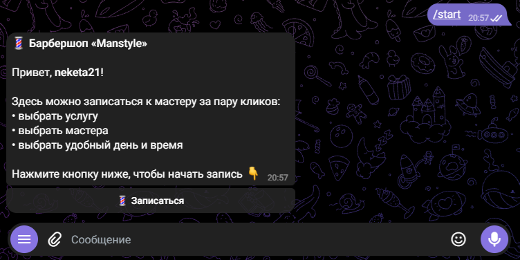
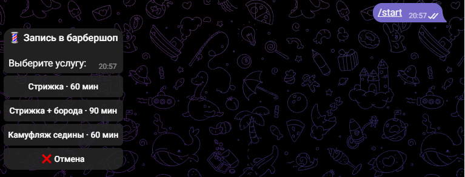
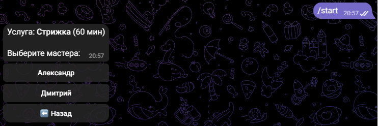
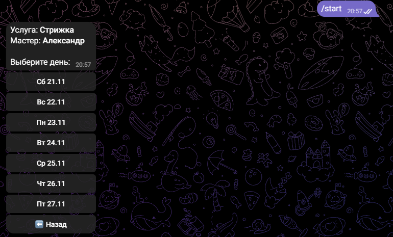
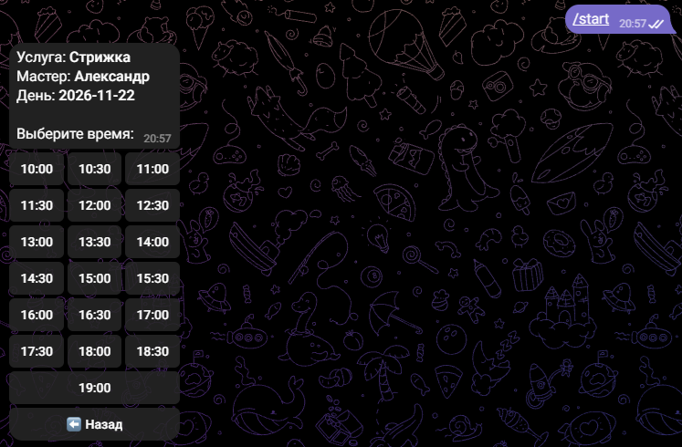
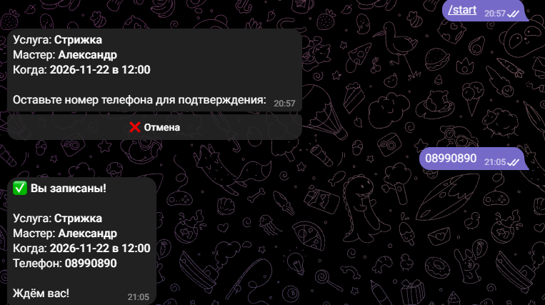

# 💈 Barber Shop Booking Bot

Telegram-бот для автоматизации записи в барбершоп. Клиент выбирает услугу, мастера, день и свободный слот, оставляет телефон — администратор получает уведомление о новой записи в Telegram. Ручная запись в переписке и двойные брони исключены.

**Живое демо:** [@ManHairStyle_bot](https://t.me/ManHairStyle_bot) — попробуйте записаться, это займёт 30 секунд.

---

## ✨ Возможности

- 💈 **Пошаговая запись** через FSM: услуга → мастер → день → слот → телефон → подтверждение
- ⏰ **Свободные слоты считаются «на лету»** с учётом длительности услуги и графика мастера — не хранятся отдельно, поэтому не «дрейфуют» относительно реальных записей
- 🔒 **Защита от двойных броней** через атомарную транзакцию SQLite (`BEGIN IMMEDIATE`) с повторной проверкой интервала — два клиента не займут одно время даже при одновременном нажатии
- 🔔 **Уведомление администратору** о каждой новой записи
- ↩️ Кнопки «Назад» и «Отмена» на каждом шаге
- 🧠 **FSM-состояния** — бот не путается, если клиент пишет что-то не по делу

---

## 🖼 Скриншоты

| Приветствие | Выбор услуги |
|---|---|
|  |  |

| Выбор мастера | Выбор дня |
|---|---|
|  |  |

| Выбор времени | Подтверждение |
|---|---|
|  |  |
---

## 🛠 Стек

- **Python 3.13**
- **aiogram 3** — современный асинхронный фреймворк для Telegram-ботов
- **SQLite + aiosqlite** — лёгкая БД, не требующая отдельного сервера
- **pydantic-settings** — типизированная конфигурация из `.env`
- **FSM** (Finite State Machine) — управление состояниями диалога

---

## 🏗 Как устроена защита от двойных броней

Классическая ошибка — хранить «свободные слоты» отдельно от броней. Тогда при удалении или изменении брони слот может «потеряться» или «заняться дважды».

Здесь подход другой:

1. **Свободные слоты не хранятся.** Функция `get_free_slots(master, day, duration)` генерирует все возможные слоты по графику и вычитает из них реальные активные брони мастера на этот день.
2. **Запись создаётся атомарно.** В момент подтверждения `create_booking()` открывает транзакцию `BEGIN IMMEDIATE`, **заново проверяет**, что интервал не пересекается ни с одной активной бронью, и только тогда делает `INSERT`. Если слот заняли между показом клавиатуры и нажатием «Подтвердить» — клиент получает сообщение «слот только что заняли» и обновлённую клавиатуру.

Это устраняет целый класс багов «двое записались на одно время».

```python
# database/db.py — упрощённо
async with aiosqlite.connect(DB_PATH) as db:
    await db.execute("BEGIN IMMEDIATE")
    async with db.execute(
        "SELECT 1 FROM bookings "
        "WHERE master = ? AND status = 'active' "
        "  AND start_time < ? AND end_time > ?",
        (master, end_s, start_s),
    ) as cursor:
        if await cursor.fetchone() is not None:
            await db.rollback()
            return False  # слот занят
    await db.execute("INSERT INTO bookings (...) VALUES (...)", (...))
    await db.commit()
    return True
```

---

## 🚀 Локальный запуск

```bash
# 1. Клонировать
git clone https://github.com/nekata21/hair-bot.git
cd hair-bot

# 2. Виртуальное окружение
python -m venv venv
venv\Scripts\activate          # Windows
# source venv/bin/activate      # macOS / Linux

# 3. Зависимости
pip install -r requirements.txt

# 4. Настроить токен
copy .env.example .env          # Windows
# cp .env.example .env          # macOS / Linux
# вписать BOT_TOKEN и ADMINS в .env

# 5. Запустить
python app.py
```

---

## ⚙️ Конфигурация

Все настройки — в `.env` (см. `.env.example`):

| Переменная | Обязательна | Описание |
|---|---|---|
| `BOT_TOKEN` | ✅ | Токен из [@BotFather](https://t.me/BotFather) |
| `ADMINS` | ✅ | Telegram ID администраторов через запятую (`820449744,123456789`) |
| `USE_REDIS` | ❌ | `false` по умолчанию (MemoryStorage). `true` — если есть Redis |
| `REDIS_HOST` / `REDIS_PORT` | ❌ | Только если `USE_REDIS=true` |

**Настройки барбершопа** (услуги, мастера, график) — в одном месте:

- `keyboards/inline/booking.py` → словари `SERVICES` и `MASTERS`
- `database/db.py` → `WORKDAY_START_HOUR`, `WORKDAY_END_HOUR`, `SLOT_STEP_MINUTES`

---

## ☁️ Деплой

Бот развёрнут на **Railway** (бесплатный тариф). Файл `Procfile` говорит Railway запускать его как фоновый worker:

```
worker: python app.py
```

Переменные `BOT_TOKEN` и `ADMINS` задаются в панели Railway → Variables. При каждом `git push` в `main` Railway автоматически пересобирает и перезапускает бота.

---

## 📬 Контакты

- Telegram: [@ManHairStyle_bot](https://t.me/ManHairStyle_bot) (демо)
- GitHub: [@neketa21](https://github.com/neketa21)

Если нужен такой бот под ваш барбершоп или салон — напишите в Telegram.